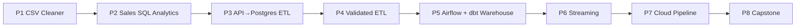

# Data Engineer Roadmap — Dari Fundamental sampai Siap Melamar Junior Data Engineer

Roadmap belajar berbasis proyek (Project-Based Learning) untuk menjadi **Junior / Entry-Level Data Engineer**. Semua progres dilacak lewat checklist di file ini.

---

## 1. Introduction

- **Profil:** Mahasiswa S1 Informatika, sudah pernah membuat ETL sederhana (Python + API + PostgreSQL).
- **Target:** Junior Data Engineer.
- **Lingkungan:** Fedora Linux & Windows, VS Code / Zed, Git + GitHub, Docker.
- **Waktu:** 10–15 jam/minggu (asumsi 12 jam). Total estimasi **±46 minggu (~11 bulan)**.
- **Catatan jujur:** durasi hanyalah perkiraan. Indikator kesiapan adalah **kompetensi + proyek yang jalan**, bukan jumlah minggu.

## 2. Learning Objectives

Setelah menyelesaikan roadmap ini kamu mampu:

- Menulis SQL yang benar dan efisien (join, window function, CTE, `EXPLAIN`).
- Menulis Python yang rapi, teruji, dan siap dipakai di pipeline.
- Mendesain skema database dan data model (3NF, star schema).
- Membangun pipeline ETL/ELT yang idempotent, terjadwal, dan punya data validation.
- Memakai Docker, Airflow, dbt, Spark (dasar), Kafka (dasar), dan satu cloud (GCP).
- Menulis logging, test, CI, dan dokumentasi teknis.
- Menjelaskan proyek portofolio di interview.

## 3. Learning Philosophy

1. **Fundamental dulu, tools kemudian.** Tidak ada Airflow/Spark/Kafka/Cloud sebelum Python, SQL, database, dan ETL dasar kuat.
2. **Satu primary stack.** Cukup dalam di satu stack daripada dangkal di dua puluh tools.
3. **Tantangan dulu, solusi belakangan.** Coba sendiri, baru bandingkan dengan referensi.
4. **Setiap fase = output nyata** (latihan + mini-project + commit di GitHub).
5. **Gate kelulusan.** Lanjut ke fase berikutnya hanya jika _acceptance criteria_ terpenuhi.
6. **Kode terbaik adalah kode yang tidak perlu ditulis:** pakai fitur bawaan (stdlib, SQL, Postgres) sebelum menambah library.

## 4. Technology Stack

### Primary Stack (dipakai di sebagian besar proyek)

`Python (uv)` · `PostgreSQL` · `SQL` · `Pandas → Polars` · `Parquet` · `Docker Compose` · `Airflow` · `dbt (Postgres adapter)` · `pytest` · `GitHub Actions` · `PySpark (local)` · `Kafka (dasar)` · `GCP (BigQuery + GCS)`

### Klasifikasi

| Level         | Teknologi                  | Fungsi                                | Kapan             | Alternatif           |
| ------------- | -------------------------- | ------------------------------------- | ----------------- | -------------------- |
| **Essential** | Python                     | Bahasa utama pipeline                 | Fase 1            | —                    |
|               | SQL + PostgreSQL           | Query, modeling, warehouse lokal      | Fase 2            | MySQL, SQL Server    |
|               | Bash + Linux               | Otomasi, server, debugging            | Fase 0            | PowerShell (Windows) |
|               | Git + GitHub               | Version control, kolaborasi           | Fase 0            | GitLab               |
|               | uv                         | Package & virtualenv Python           | Fase 0            | pip + venv, poetry   |
|               | CSV / JSON / Parquet       | Format data                           | Fase 4            | Avro                 |
|               | Docker + Compose           | Environment reproducible              | Fase 6            | Podman               |
|               | pytest                     | Test kode & transformasi              | Fase 5            | unittest             |
| **Important** | Pandas, Polars, PyArrow    | Pemrosesan data in-memory             | Fase 1 & 4        | DuckDB               |
|               | Apache Airflow             | Orkestrasi workflow                   | Fase 7            | Prefect, Dagster     |
|               | dbt                        | Transformasi SQL (ELT)                | Fase 8            | SQLMesh              |
|               | GitHub Actions             | CI/CD                                 | Fase 10           | GitLab CI            |
|               | Satu cloud (GCP)           | Cloud data engineering                | Fase 10           | AWS, Azure           |
|               | BigQuery                   | Cloud data warehouse                  | Fase 8/10         | Redshift, Snowflake  |
| **Advanced**  | Apache Spark               | Distributed batch processing          | Fase 9            | Dask, Flink          |
|               | Apache Kafka               | Streaming                             | Fase 9            | Redpanda, Pub/Sub    |
|               | Terraform                  | Infrastructure as Code                | Fase 10           | Pulumi               |
|               | Great Expectations / Soda  | Data quality framework                | Fase 5 (opsional) | dbt tests            |
| **Optional**  | Apache Iceberg, Avro       | Table format / serialization lanjutan | Setelah Fase 9    | Delta Lake           |
|               | Snowflake, Redshift, Azure | Sesuai kebutuhan kerja                | Saat dibutuhkan   | —                    |
|               | Prefect                    | Orkestrasi alternatif                 | Saat dibutuhkan   | Airflow              |

> **Pertanyaan malas-tapi-benar:** Great Expectations dan Soda tidak wajib di awal — `pytest` + `dbt tests` sudah mencakup 90% kebutuhan junior. Pelajari belakangan jika lowongan menuntut.

## 5. Roadmap Overview

```mermaid
flowchart LR
  F0[Fase 0<br/>Setup, Linux, Git] --> F1[Fase 1<br/>Python for DE]
  F1 --> F2[Fase 2<br/>SQL & PostgreSQL]
  F2 --> F3[Fase 3<br/>Data Modeling]
  F3 --> F4[Fase 4<br/>ETL/ELT, API, Format]
  F4 --> F5[Fase 5<br/>Quality, Testing, Logging]
  F5 --> F6[Fase 6<br/>Docker]
  F6 --> F7[Fase 7<br/>Airflow]
  F7 --> F8[Fase 8<br/>Warehouse & dbt]
  F8 --> F9[Fase 9<br/>Spark & Kafka]
  F9 --> F10[Fase 10<br/>Cloud, IaC, CI/CD, Security]
  F10 --> F11[Fase 11<br/>Capstone & Career]
```



| Fase | Topik                                      | Cakupan item roadmap | Durasi         |
| ---- | ------------------------------------------ | -------------------- | -------------- |
| 0    | Setup, Linux, Git                          | 5, 6                 | 2 minggu       |
| 1    | Python for Data Engineering                | 1, 2                 | 4 minggu       |
| 2    | SQL & PostgreSQL                           | 3                    | 4 minggu       |
| 3    | Database Design & Data Modeling            | 4                    | 3 minggu       |
| 4    | Data Formats, ETL, ELT, REST API           | 7, 8, 9, 10          | 4 minggu       |
| 5    | Data Quality, Testing, Logging             | 14, 20 (dasar)       | 3 minggu       |
| 6    | Docker & Containerization                  | 15                   | 2 minggu       |
| 7    | Pipeline Orchestration                     | 12                   | 4 minggu       |
| 8    | Data Warehouse, Data Lake, dbt             | 11, 13               | 5 minggu       |
| 9    | Big Data: Spark & Kafka                    | 16, 17               | 5 minggu       |
| 10   | Cloud, Deployment, Observability, Security | 18, 19, 20, 21       | 5 minggu       |
| 11   | Production-Ready, Portfolio, Interview     | 22, 23, 24           | 5 minggu       |
|      | **Total**                                  |                      | **±46 minggu** |

**Pembagian waktu per minggu (12 jam):** 30% teori/baca dokumentasi (±4 jam) · 70% praktik/proyek (±8 jam).

---

## 6. Detailed Learning Phases

> Format setiap fase: Tujuan → Kompetensi → Konsep → Tools → Latihan → Mini-project → Main project → Resource → Acceptance Criteria → Checklist.

---

### Fase 0 — Setup, Linux & Git (2 minggu)

**Tujuan:** Lingkungan kerja reproducible dan nyaman di terminal.

**Kompetensi:** navigasi shell, permission, pipe/redirect, `grep/sed/awk` dasar, cron, Git workflow (branch, PR, merge, rebase dasar), `uv`.

**Konsep:** filesystem hierarchy, proses, environment variable, `.gitignore`, commit message yang baik, `.env` dan secret tidak boleh masuk Git.

**Tools:** Fedora (`dnf`), Bash, Git, GitHub, `uv`, VS Code/Zed.

**Latihan**

- [ ] Kerjakan 20 level Linux Journey (command line, file, pipes).
- [ ] Script Bash: backup folder + rotasi 7 hari, jalankan via `cron`.
- [ ] Latihan Git: buat konflik merge sengaja lalu selesaikan.
- [ ] `uv init`, `uv add`, `uv run`, `uv sync` pada proyek kosong.

**Mini-project:** repo `data-engineering-journey` dengan struktur dari bagian 8 + CI kosong (lint).

**Main project:** — (tidak ada, setup saja).

| Resource                   | URL                            | Materi                          | Alasan                          |
| -------------------------- | ------------------------------ | ------------------------------- | ------------------------------- |
| Linux Journey              | https://linuxjourney.com/      | Command line, pipes, permission | Interaktif, gratis              |
| Pro Git (Bahasa Indonesia) | https://git-scm.com/book/id/v2 | Bab 1–3                         | Referensi resmi, ada terjemahan |
| Dokumentasi uv             | https://docs.astral.sh/uv/     | Projects, dependencies          | Resmi                           |
| Petani Kode                | https://www.petanikode.com/    | Linux & Git dasar               | Bahasa Indonesia                |

**Acceptance Criteria**

- Clone repo di Fedora _dan_ Windows, `uv sync` berhasil di keduanya.
- Bisa membuat branch → PR → merge sendiri di GitHub.

**Checklist**

- [ ] Repo journey dibuat
- [ ] `uv` terpasang & dipakai
- [ ] Script Bash + cron jalan
- [ ] 1 PR berhasil di-merge

---

### Fase 1 — Python for Data Engineering (4 minggu)

**Tujuan:** Python yang cukup kuat untuk menulis pipeline yang bersih.

**Kompetensi:** tipe data, fungsi, error handling, file I/O, modul, `requests`, Pandas dasar, type hints, struktur proyek sederhana.

**Konsep:** immutability vs mutability, generator & iterator (memproses data besar), context manager, exception handling, virtualenv, 12-factor config (env var).

**Tools:** Python, uv, Pandas, `requests`, `pathlib`, `csv`, `json`, `logging`.

**Latihan**

- [ ] 30 soal dasar Python (struktur data, string, fungsi).
- [ ] Baca CSV 1 GB dengan generator (tanpa Pandas), hitung agregasi.
- [ ] Pandas: `groupby`, `merge`, `pivot`, handling missing value.
- [ ] Panggil 1 REST API publik dengan retry sederhana.

**Mini-project:** _CSV Cleaner CLI_ — baca CSV kotor, bersihkan, tulis CSV bersih + laporan baris yang ditolak.

**Main project → Project 1** (lihat bagian 7).

| Resource                       | URL                                                  | Materi                           | Alasan              |
| ------------------------------ | ---------------------------------------------------- | -------------------------------- | ------------------- |
| Python Tutorial                | https://docs.python.org/3/tutorial/                  | Bab 1–9, 11                      | Sumber resmi        |
| Pandas: 10 minutes             | https://pandas.pydata.org/docs/user_guide/10min.html | Dasar DataFrame                  | Singkat & resmi     |
| freeCodeCamp                   | https://www.freecodecamp.org/                        | Scientific Computing with Python | Gratis, terstruktur |
| Programmer Zaman Now (YouTube) | https://www.youtube.com/@ProgrammerZamanNow          | Python dasar                     | Bahasa Indonesia    |

**Acceptance Criteria**

- Bisa menjelaskan kapan memakai generator vs list.
- Script jalan dengan `uv run`, config lewat env var, tidak ada hardcoded path/secret.

**Checklist**

- [ ] 30 soal selesai
- [ ] CSV Cleaner CLI di GitHub
- [ ] Project 1 selesai
- [ ] Quiz mentor lulus

---

### Fase 2 — SQL & PostgreSQL (4 minggu)

**Tujuan:** SQL fasih dan paham cara kerja query di Postgres.

**Kompetensi:** `SELECT`, join, agregasi, subquery, CTE, window function, DDL/DML, index, transaksi, `EXPLAIN ANALYZE`.

**Konsep:** ACID, isolation level, index B-tree, query plan, `NULL` semantics, `UPSERT` (`ON CONFLICT`).

**Tools:** PostgreSQL, `psql`, DBeaver (opsional), `psycopg`/SQLAlchemy.

**Latihan**

- [ ] SQLBolt tuntas.
- [ ] PG Exercises: minimal 60 soal.
- [ ] 20 soal window function (ranking, running total, LAG/LEAD).
- [ ] Bandingkan query lambat sebelum/sesudah index dengan `EXPLAIN ANALYZE`.

**Mini-project:** _Analisis dataset penjualan_ — 10 pertanyaan bisnis dijawab dengan SQL, disimpan di `sql/`.

**Main project → Project 2.**

| Resource            | URL                                                        | Materi                     | Alasan                 |
| ------------------- | ---------------------------------------------------------- | -------------------------- | ---------------------- |
| SQLBolt             | https://sqlbolt.com/                                       | Lesson 1–18                | Interaktif             |
| PG Exercises        | https://pgexercises.com/                                   | Semua kategori             | Latihan Postgres nyata |
| PostgreSQL Tutorial | https://www.postgresql.org/docs/current/tutorial.html      | SQL, indexes, transactions | Resmi                  |
| Postgres `EXPLAIN`  | https://www.postgresql.org/docs/current/using-explain.html | Membaca plan               | Skill optimasi         |

**Acceptance Criteria**

- Bisa menulis query window function tanpa contekan.
- Bisa menjelaskan mengapa sebuah query memakai Seq Scan vs Index Scan.

**Checklist**

- [ ] SQLBolt & 60 soal PG Exercises
- [ ] Mini-project SQL di GitHub
- [ ] Project 2 selesai
- [ ] Quiz mentor lulus

---

### Fase 3 — Database Design & Data Modeling (3 minggu)

**Tujuan:** Mendesain skema yang benar untuk OLTP dan analitik.

**Kompetensi:** ERD, normalisasi (1NF–3NF), constraint, dimensional modeling (fact/dimension, star schema, SCD Type 1/2).

**Konsep:** grain tabel fakta, surrogate vs natural key, denormalisasi untuk analitik, OLTP vs OLAP.

**Tools:** PostgreSQL, dbdiagram.io / Mermaid ER.

**Latihan**

- [ ] Normalisasi tabel "excel kotor" sampai 3NF.
- [ ] Gambar ERD untuk e-commerce (Mermaid).
- [ ] Implementasi SCD Type 2 untuk dimensi pelanggan dengan SQL murni.

**Mini-project:** Star schema untuk dataset penjualan (1 fact, 3 dim).

**Main project:** dilanjutkan di Project 3 dan Project 5.

| Resource                                        | URL                                                                                                                             | Materi               | Alasan       |
| ----------------------------------------------- | ------------------------------------------------------------------------------------------------------------------------------- | -------------------- | ------------ |
| Dimensional Modeling Techniques (Kimball Group) | https://www.kimballgroup.com/data-warehouse-business-intelligence-resources/kimball-techniques/dimensional-modeling-techniques/ | Fact, dimension, SCD | Sumber asli  |
| Mermaid ER Diagram                              | https://mermaid.js.org/syntax/entityRelationshipDiagram.html                                                                    | ERD sebagai kode     | Masuk README |
| PostgreSQL Constraints                          | https://www.postgresql.org/docs/current/ddl-constraints.html                                                                    | PK, FK, CHECK        | Resmi        |

**Acceptance Criteria**

- Bisa menyebut grain setiap tabel fakta dan membenarkannya.
- Bisa menjelaskan kapan SCD2 diperlukan.

**Checklist**

- [ ] ERD di repo
- [ ] Star schema berjalan
- [ ] SCD2 berhasil diuji dengan data berubah
- [ ] Quiz mentor lulus

---

### Fase 4 — Data Formats, ETL, ELT & REST API (4 minggu)

**Tujuan:** Membangun pipeline batch yang idempotent dan bisa dipercaya.

**Kompetensi:** CSV/JSON/Parquet, API pagination/rate limit/retry, incremental load, upsert, staging, ETL vs ELT.

**Konsep:** idempotency, incremental vs full load, watermark, schema evolution, columnar vs row format, backfill.

**Tools:** Python, `requests`, Pandas/Polars, PyArrow, PostgreSQL.

**Latihan**

- [ ] Konversi dataset CSV → JSON → Parquet; bandingkan ukuran & waktu baca.
- [ ] Load incremental dengan watermark `updated_at`.
- [ ] Jalankan pipeline 2x, hasil harus sama (idempotent).
- [ ] Tangani API 429/500 dengan exponential backoff.

**Mini-project:** _API → staging → Postgres_ dengan tabel `etl_runs` (log tiap run).

**Main project → Project 3.**

| Resource                       | URL                                                        | Materi                | Alasan                       |
| ------------------------------ | ---------------------------------------------------------- | --------------------- | ---------------------------- |
| Parquet docs                   | https://parquet.apache.org/docs/                           | Konsep kolumnar       | Resmi                        |
| Polars User Guide              | https://docs.pola.rs/                                      | Lazy API, expressions | Alternatif Pandas yang cepat |
| Requests docs                  | https://requests.readthedocs.io/                           | Session, timeout      | Resmi                        |
| DE Zoomcamp (Module Ingestion) | https://github.com/DataTalksClub/data-engineering-zoomcamp | Ingestion ke Postgres | Gratis, praktis              |

**Acceptance Criteria**

- Pipeline dijalankan berulang tanpa duplikat.
- Kegagalan di tengah run tidak meninggalkan data setengah jadi (transaksi).

**Checklist**

- [ ] Parquet vs CSV benchmark
- [ ] Incremental load jalan
- [ ] Project 3 selesai
- [ ] Quiz mentor lulus

---

### Fase 5 — Data Quality, Testing & Logging (3 minggu)

**Tujuan:** Pipeline yang gagal dengan jelas, bukan diam-diam salah.

**Kompetensi:** unit test, test data transformasi, validasi skema, `logging`, error handling, troubleshooting.

**Konsep:** test pyramid untuk data, validasi di trust boundary, fail fast, dead-letter / rejected table, dimensi data quality (completeness, uniqueness, validity, freshness).

**Tools:** pytest, `logging`, Pydantic (opsional), Great Expectations/Soda (opsional).

**Latihan**

- [ ] Tulis 15 test untuk fungsi transformasi Fase 4.
- [ ] Validasi skema + range + uniqueness; baris buruk masuk tabel `rejected_rows`.
- [ ] Ganti `print` dengan `logging` terstruktur (level, run_id).
- [ ] Debug pipeline "rusak" dari mentor (3 skenario bug).

**Mini-project:** Tambahkan lapisan validasi + test ke Project 3.

**Main project:** bagian dari Project 4.

| Resource             | URL                                          | Materi                  | Alasan           |
| -------------------- | -------------------------------------------- | ----------------------- | ---------------- |
| pytest docs          | https://docs.pytest.org/                     | Fixtures, parametrize   | Resmi            |
| Python Logging HOWTO | https://docs.python.org/3/howto/logging.html | Logger, handler         | Resmi            |
| Great Expectations   | https://docs.greatexpectations.io/           | Expectations (opsional) | Standar industri |
| Soda docs            | https://docs.soda.io/                        | Checks (opsional)       | Alternatif       |

**Acceptance Criteria**

- Data buruk tidak merusak load; terekam di `rejected_rows` dengan alasan.
- `uv run pytest` hijau; log cukup untuk menelusuri kegagalan tanpa debugger.

**Checklist**

- [ ] ≥15 test lulus
- [ ] Logging terstruktur
- [ ] Project 4 selesai
- [ ] Quiz mentor lulus

---

### Fase 6 — Docker & Containerization (2 minggu)

**Tujuan:** Pipeline berjalan identik di laptop, CI, dan server.

**Kompetensi:** Dockerfile, image layer, volume, network, Docker Compose, healthcheck.

**Konsep:** image vs container, layer caching, multi-stage build, secret via env/`.env`, jangan jalan sebagai root.

**Tools:** Docker, Docker Compose.

**Latihan**

- [ ] Dockerize script Fase 1 (image kecil dengan `uv`).
- [ ] Compose: Postgres + pipeline + pgAdmin dengan volume persisten.
- [ ] Tambah `healthcheck` dan `depends_on: condition: service_healthy`.

**Mini-project:** `docker compose up` menjalankan seluruh Project 3 dari nol.

**Main project:** dipakai di semua proyek berikutnya.

| Resource                  | URL                                                    | Materi                   | Alasan           |
| ------------------------- | ------------------------------------------------------ | ------------------------ | ---------------- |
| Docker Get Started        | https://docs.docker.com/get-started/                   | Image, container, volume | Resmi            |
| Compose docs              | https://docs.docker.com/compose/                       | Services, networks       | Resmi            |
| Dockerfile best practices | https://docs.docker.com/build/building/best-practices/ | Layer, multi-stage       | Praktik industri |

**Acceptance Criteria**

- Orang lain `git clone` + `docker compose up` → pipeline jalan tanpa instalasi lain.

**Checklist**

- [ ] Dockerfile ringkas
- [ ] Compose lengkap dengan healthcheck
- [ ] Quiz mentor lulus

---

### Fase 7 — Pipeline Orchestration (4 minggu)

**Tujuan:** Menjadwalkan, memantau, dan memulihkan pipeline.

**Kompetensi:** DAG, task dependency, scheduling, retry, backfill, sensor, XCom (secukupnya), connection & variable.

**Konsep:** idempotent task, `data_interval`, catchup, atomic task, orchestrator ≠ tempat memproses data (orchestrator hanya mengatur).

**Tools:** Apache Airflow (Docker Compose), TaskFlow API.

**Latihan**

- [ ] DAG "hello" 3 task berurutan.
- [ ] DAG yang menjalankan pipeline Fase 4 harian, dengan retry & alert (log).
- [ ] Backfill 7 hari ke belakang, pastikan tidak duplikat.
- [ ] Sengaja gagalkan task, pulihkan dari UI.

**Mini-project:** Orkestrasi Project 3 dengan Airflow.

**Main project → Project 5 (bagian orkestrasi).**

| Resource                    | URL                                                                                   | Materi                 | Alasan     |
| --------------------------- | ------------------------------------------------------------------------------------- | ---------------------- | ---------- |
| Airflow Tutorial            | https://airflow.apache.org/docs/apache-airflow/stable/tutorial/                       | DAG, TaskFlow          | Resmi      |
| Airflow Docker Compose      | https://airflow.apache.org/docs/apache-airflow/stable/howto/docker-compose/index.html | Setup lokal            | Cara resmi |
| DE Zoomcamp (Orchestration) | https://github.com/DataTalksClub/data-engineering-zoomcamp                            | Workflow orchestration | Praktis    |

**Acceptance Criteria**

- Backfill dan rerun tidak menghasilkan duplikat.
- Bisa menjelaskan beda `logical_date` dan waktu eksekusi sebenarnya.

**Checklist**

- [ ] Airflow jalan di Compose
- [ ] DAG harian + retry
- [ ] Backfill sukses
- [ ] Quiz mentor lulus

---

### Fase 8 — Data Warehouse, Data Lake & dbt (5 minggu)

**Tujuan:** Membangun layer analitik yang terstruktur dan teruji.

**Kompetensi:** warehouse vs lake vs lakehouse, layering (raw/staging/marts), ELT, dbt models/tests/docs, incremental model, snapshot.

**Konsep:** ELT, medallion/layered architecture, partitioning, kolumnar storage, object storage, lineage.

**Tools:** PostgreSQL (warehouse lokal), dbt-postgres, object storage (MinIO atau GCS), Parquet.

**Latihan**

- [ ] Bangun layer `staging → intermediate → marts` dengan dbt.
- [ ] Tambah test dbt: `unique`, `not_null`, `relationships`, `accepted_values`.
- [ ] Buat incremental model + snapshot (SCD2).
- [ ] Simpan raw data sebagai Parquet di object storage (MinIO/GCS).
- [ ] `dbt docs generate` dan lihat lineage.

**Mini-project:** dbt project di atas star schema Fase 3.

**Main project → Project 5.**

| Resource                            | URL                                                        | Materi                   | Alasan                    |
| ----------------------------------- | ---------------------------------------------------------- | ------------------------ | ------------------------- |
| dbt Docs                            | https://docs.getdbt.com/                                   | Models, tests, snapshots | Resmi                     |
| dbt Learn                           | https://learn.getdbt.com/                                  | dbt Fundamentals         | Kursus gratis resmi       |
| MinIO Docs                          | https://min.io/docs/minio/linux/index.html                 | S3-compatible lokal      | Praktik tanpa biaya cloud |
| DE Zoomcamp (Analytics Engineering) | https://github.com/DataTalksClub/data-engineering-zoomcamp | dbt + warehouse          | Praktis                   |

**Acceptance Criteria**

- `dbt build` hijau (model + test) dari database kosong.
- Bisa menjelaskan kapan memilih warehouse vs data lake.

**Checklist**

- [ ] dbt project berjalan
- [ ] Test & docs ada
- [ ] Incremental + snapshot
- [ ] Project 5 selesai
- [ ] Quiz mentor lulus

---

### Fase 9 — Big Data: Spark & Kafka (5 minggu)

**Tujuan:** Paham _kapan_ dan _bagaimana_ memproses data terdistribusi dan streaming.

**Kompetensi:** PySpark DataFrame, transformasi lazy, partitioning, shuffle, baca/tulis Parquet; Kafka topic/partition/consumer group; batch vs streaming.

**Konsep:** distributed processing, lazy evaluation, data skew, at-least-once vs exactly-once, offset, windowing.

**Tools:** PySpark (mode local), Kafka (Docker Compose), Python client.

**Latihan**

- [ ] Ulangi agregasi Fase 4 dengan PySpark, bandingkan dengan Polars.
- [ ] Baca `.explain()` dan identifikasi shuffle.
- [ ] Producer & consumer Kafka dengan Python.
- [ ] Spark Structured Streaming baca dari Kafka (window 1 menit).

**Mini-project:** Streaming counter: event dummy → Kafka → Spark → Postgres.

**Main project → Project 6.**

| Resource                        | URL                                                        | Materi                     | Alasan  |
| ------------------------------- | ---------------------------------------------------------- | -------------------------- | ------- |
| Spark Docs (PySpark)            | https://spark.apache.org/docs/latest/api/python/index.html | Getting started, DataFrame | Resmi   |
| Structured Streaming Guide      | https://spark.apache.org/docs/latest/streaming/index.html  | Streaming                  | Resmi   |
| Kafka Documentation             | https://kafka.apache.org/documentation/                    | Intro, quickstart          | Resmi   |
| DE Zoomcamp (Batch & Streaming) | https://github.com/DataTalksClub/data-engineering-zoomcamp | Spark & Kafka              | Praktis |

**Acceptance Criteria**

- Bisa menjelaskan kapan Spark **tidak** diperlukan (data muat di satu mesin).
- Pipeline streaming berjalan dan tahan restart (checkpoint).

**Checklist**

- [ ] PySpark batch job
- [ ] Kafka producer/consumer
- [ ] Streaming job dengan checkpoint
- [ ] Project 6 selesai
- [ ] Quiz mentor lulus

---

### Fase 10 — Cloud, Deployment, Observability & Security (5 minggu)

**Tujuan:** Memindahkan pipeline ke cloud secara aman dan terpantau.

**Kompetensi:** GCP (GCS, BigQuery, IAM, Cloud Run/Compute), Terraform dasar, GitHub Actions CI/CD, monitoring, secret management, governance dasar.

**Konsep:** least privilege IAM, service account, IaC, CI/CD, freshness/volume monitoring, PII masking, retensi data, kontrol biaya (budget alert).

**Tools:** GCP, Terraform, GitHub Actions, logging terstruktur.

**Latihan**

- [ ] Buat akun GCP, pasang **budget alert**, aktifkan BigQuery sandbox/free tier.
- [ ] Upload Parquet ke GCS, load ke BigQuery.
- [ ] Terraform: bucket + dataset BigQuery + service account.
- [ ] GitHub Actions: lint + pytest + `dbt build` saat PR.
- [ ] Masking kolom PII (email) di layer mart.

**Mini-project:** Pipeline Project 5 versi GCP (GCS → BigQuery → dbt-bigquery).

**Main project → Project 7.**

| Resource                 | URL                                                 | Materi                            | Alasan           |
| ------------------------ | --------------------------------------------------- | --------------------------------- | ---------------- |
| Google Cloud Training    | https://cloud.google.com/learn/training             | Data Engineer learning path       | Resmi            |
| BigQuery Sandbox         | https://cloud.google.com/bigquery/docs/sandbox      | Pakai BigQuery tanpa kartu kredit | Gratis           |
| Terraform Tutorials      | https://developer.hashicorp.com/terraform/tutorials | Get started (GCP)                 | Resmi            |
| GitHub Actions Docs      | https://docs.github.com/en/actions                  | Workflow syntax                   | Resmi            |
| AWS Training (referensi) | https://aws.amazon.com/training/                    | Konsep S3/Redshift                | Pembanding cloud |

**Acceptance Criteria**

- Tidak ada secret/credential di repo; akses via IAM least privilege.
- PR otomatis menjalankan test dan memblok merge jika gagal.
- Biaya terpantau (budget alert aktif).

**Checklist**

- [ ] Budget alert aktif
- [ ] Terraform apply/destroy sukses
- [ ] CI berjalan di PR
- [ ] Project 7 selesai
- [ ] Quiz mentor lulus

---

### Fase 11 — Production-Ready, Portfolio & Interview (5 minggu)

**Tujuan:** Capstone end-to-end dan siap interview.

**Kompetensi:** desain sistem data sederhana, dokumentasi, runbook, presentasi proyek, soal SQL/Python, behavioral.

**Latihan**

- [ ] 50 soal SQL (join, window, CTE) dengan batas waktu.
- [ ] 30 soal Python (struktur data, string, parsing).
- [ ] 5 case study: desain pipeline dari kebutuhan bisnis (tulis 1 halaman tiap kasus).
- [ ] 3 mock interview (teman / mentor).
- [ ] Rapikan 3 repo terbaik: README, diagram arsitektur, cara menjalankan.

**Main project → Project 8 (Capstone).**

| Resource                                                          | URL                                                                      | Materi                     | Alasan                         |
| ----------------------------------------------------------------- | ------------------------------------------------------------------------ | -------------------------- | ------------------------------ |
| Data Engineering Zoomcamp                                         | https://github.com/DataTalksClub/data-engineering-zoomcamp               | Final project              | Pola capstone                  |
| DataTalks.Club                                                    | https://datatalks.club/                                                  | Komunitas & interview tips | Komunitas DE aktif             |
| StrataScratch / LeetCode (SQL)                                    | https://leetcode.com/problemset/database/                                | Soal SQL                   | Latihan interview              |
| Fundamentals of Data Engineering (buku, Reis & Housley, O'Reilly) | https://www.oreilly.com/library/view/fundamentals-of-data/9781098108298/ | Seluruh lifecycle          | Referensi terbaik untuk konsep |

**Acceptance Criteria**

- Capstone bisa dijalankan orang lain dengan 1–3 perintah.
- Bisa menjelaskan setiap keputusan desain (kenapa tool X, bukan Y) selama 10 menit.

**Checklist**

- [ ] 50 SQL & 30 Python selesai
- [ ] 5 case study ditulis
- [ ] 3 mock interview
- [ ] Capstone selesai
- [ ] CV + LinkedIn + GitHub profile dirapikan

---

## 7. Project-Based Learning Plan

> Aturan: tiap proyek punya **tantangan mandiri** (ditandai 🔥) yang tidak ada di tutorial mana pun. Mentor memberi tantangan dulu; kamu kerjakan; baru review.



### Level 1 — Beginner

#### Project 1 — Data Cleaning Toolkit

- **Business problem:** Data mentah dari tim operasional penuh typo, duplikat, tanggal tidak konsisten.
- **Objectives:** Python, Pandas, file I/O, CLI.
- **Use case:** Preprocessing data sebelum masuk database.
- **Dataset:** Kaggle "Brazilian E-Commerce (Olist)" atau data publik data.go.id.
- **Tech stack:** Python, uv, Pandas, pytest.
- **Arsitektur / data flow:** `raw CSV → clean() → clean CSV + rejected CSV + report`.
- **Struktur folder:**
    ```
    p1-data-cleaning/
    ├── main.py
    ├── cleaning.py
    ├── tests/test_cleaning.py
    ├── data/raw/  data/clean/
    ├── pyproject.toml
    └── README.md
    ```
- **Implementation steps:** profil data → definisikan aturan → fungsi bersih per aturan → CLI → laporan.
- **Expected output:** file bersih + laporan jumlah baris diterima/ditolak per alasan.
- **Testing:** 1 test per aturan pembersihan.
- **Documentation:** aturan bisnis + contoh before/after.
- **Acceptance criteria:** idempotent (jalan 2x = hasil sama); semua aturan teruji.
- 🔥 **Tantangan:** proses file 2 GB dengan memori < 500 MB.
- **Portfolio:** README + contoh output + cara menjalankan.

#### Project 2 — Sales Analytics dengan SQL

- **Business problem:** Manajer ingin tahu produk terlaris, retensi pelanggan, tren bulanan.
- **Objectives:** SQL tingkat lanjut, schema design, index.
- **Use case:** Laporan penjualan bulanan.
- **Dataset:** Olist / Northwind / AdventureWorks (PostgreSQL port).
- **Tech stack:** PostgreSQL, SQL, Docker Compose.
- **Data flow:** `CSV → COPY ke Postgres → query analitik → hasil di sql/ + laporan Markdown`.
- **Struktur folder:**
    ```
    p2-sales-sql/
    ├── docker-compose.yml
    ├── sql/ (01_schema.sql, 02_load.sql, 03_analysis.sql)
    └── README.md
    ```
- **Steps:** buat schema + constraint → load dengan `COPY` → 10–15 query bisnis → optimasi dengan index.
- **Expected output:** 10+ query terdokumentasi + hasil.
- **Testing:** query hasil dicek terhadap perhitungan manual kecil.
- **Documentation:** pertanyaan bisnis → query → insight.
- **Acceptance criteria:** minimal 3 query memakai window function; 1 query dioptimasi dengan bukti `EXPLAIN ANALYZE`.
- 🔥 **Tantangan:** cohort retention bulanan hanya dengan SQL.
- **Portfolio:** README berisi tabel insight + screenshot plan.

### Level 2 — Intermediate

#### Project 3 — API → PostgreSQL Incremental ETL

- **Business problem:** Data harga/cuaca/transaksi di API harus tersedia di database internal.
- **Objectives:** ETL idempotent, incremental load, retry.
- **Use case:** Sinkronisasi data eksternal.
- **Dataset:** API publik (mis. Open-Meteo, CoinGecko, atau API BMKG/data.go.id).
- **Tech stack:** Python, requests, Polars/Pandas, PostgreSQL, Docker Compose.
- **Data flow:** `API → raw (JSON/Parquet) → staging → upsert ke tabel final + etl_runs`.
- **Struktur folder:**
    ```
    p3-api-etl/
    ├── pipeline.py
    ├── extract.py  transform.py  load.py
    ├── sql/schema.sql
    ├── tests/
    ├── docker-compose.yml  Dockerfile
    └── README.md
    ```
- **Steps:** extract + retry → simpan raw → transform → upsert → catat run.
- **Expected output:** tabel final tanpa duplikat; riwayat run.
- **Testing:** test transform; test idempotency (jalan 2x).
- **Documentation:** diagram flow (Mermaid), cara backfill.
- **Acceptance criteria:** crash di tengah run → rerun aman; `docker compose up` jalan.
- 🔥 **Tantangan:** API berubah skema (field baru) tanpa merusak pipeline.
- **Portfolio:** README dengan diagram + contoh log.

#### Project 4 — Validated ETL dengan Data Quality Gate

- **Business problem:** Data buruk masuk dashboard dan merusak keputusan.
- **Objectives:** Validasi, testing, logging, rejected data.
- **Use case:** Kontrol kualitas sebelum load.
- **Dataset:** lanjutan Project 3 + data kotor sintetis.
- **Tech stack:** Python, pytest, Pydantic/validasi manual, logging, PostgreSQL.
- **Data flow:** `extract → validate → (valid → load) / (invalid → rejected_rows) → quality report`.
- **Struktur folder:** sama seperti P3 + `validation.py`, `tests/`, `reports/`.
- **Steps:** definisikan aturan → pisah valid/invalid → simpan alasan → ringkasan kualitas per run.
- **Expected output:** tabel `rejected_rows`, laporan kualitas (completeness, uniqueness, validity).
- **Testing:** parametrize test untuk tiap aturan.
- **Documentation:** katalog aturan validasi.
- **Acceptance criteria:** pipeline berhenti (fail fast) bila persentase reject melewati ambang.
- 🔥 **Tantangan:** deteksi anomali volume (baris hari ini turun >50%).
- **Portfolio:** README + contoh laporan kualitas.

### Level 3 — Advanced

#### Project 5 — Orchestrated Data Warehouse (Airflow + dbt)

- **Business problem:** Tim analitik butuh data mart harian yang konsisten.
- **Objectives:** Orkestrasi, warehouse layering, dbt, ELT.
- **Use case:** Pipeline harian ke star schema.
- **Dataset:** Olist (multi-tabel) atau NYC Taxi (Parquet publik) subset.
- **Tech stack:** Airflow, dbt-postgres, PostgreSQL, MinIO/Parquet, Docker Compose.
- **Data flow:** `Source → raw (Parquet/MinIO) → Postgres raw schema → dbt staging → marts → docs`.
- **Struktur folder:**
    ```
    p5-warehouse/
    ├── airflow/dags/
    ├── dbt_project/ (models/{staging,intermediate,marts}, tests/, snapshots/)
    ├── ingestion/
    ├── docker-compose.yml
    └── README.md
    ```
- **Steps:** ingestion → raw → dbt staging → fact/dim → test → jadwal harian.
- **Expected output:** `fct_orders`, `dim_customer` (SCD2), dashboard query contoh.
- **Testing:** dbt tests + data freshness.
- **Documentation:** lineage (dbt docs), diagram arsitektur.
- **Acceptance criteria:** `dbt build` hijau; backfill 7 hari tanpa duplikat.
- 🔥 **Tantangan:** late-arriving data memengaruhi fakta yang sudah dimuat.
- **Portfolio:** screenshot DAG + lineage dbt.

#### Project 6 — Streaming Pipeline (Kafka + Spark)

- **Business problem:** Monitor transaksi/klik hampir real-time.
- **Objectives:** Streaming, windowing, checkpoint.
- **Use case:** Hitung transaksi per menit & deteksi lonjakan.
- **Dataset:** Generator event sintetis (Python) berbasis Olist.
- **Tech stack:** Kafka, PySpark Structured Streaming, PostgreSQL, Docker Compose.
- **Data flow:** `Generator → Kafka topic → Spark (window agg) → Postgres`.
- **Struktur folder:**
    ```
    p6-streaming/
    ├── producer/producer.py
    ├── spark_job/stream_job.py
    ├── sql/schema.sql
    ├── docker-compose.yml
    └── README.md
    ```
- **Steps:** producer → topic → consumer sederhana → Spark windowing → sink.
- **Expected output:** tabel agregat per menit yang terus bertambah.
- **Testing:** test fungsi parsing; uji manual restart dengan checkpoint.
- **Documentation:** diagram streaming, penjelasan delivery semantics.
- **Acceptance criteria:** restart job tidak menghasilkan duplikat/kehilangan data.
- 🔥 **Tantangan:** event datang terlambat (watermark) dan duplikat event.
- **Portfolio:** demo GIF/screenshot + diagram.

### Level 4 — Production Ready

#### Project 7 — Cloud Data Pipeline (GCP + Terraform + CI/CD)

- **Business problem:** Pipeline lokal harus berjalan di cloud, terjadwal dan terpantau.
- **Objectives:** Cloud storage/warehouse, IaC, CI/CD, secret management.
- **Use case:** Migrasi Project 5 ke GCP.
- **Dataset:** sama dengan Project 5.
- **Tech stack:** GCS, BigQuery, dbt-bigquery, Terraform, GitHub Actions, Docker.
- **Data flow:** `Source → GCS (Parquet) → BigQuery raw → dbt → marts`.
- **Struktur folder:**
    ```
    p7-cloud-pipeline/
    ├── terraform/
    ├── ingestion/
    ├── dbt_project/
    ├── .github/workflows/ci.yml
    └── README.md
    ```
- **Steps:** Terraform infra → ingestion ke GCS → load BigQuery → dbt → CI → budget alert.
- **Expected output:** infra reproducible (`terraform apply`), PR dicek otomatis.
- **Testing:** CI menjalankan lint + pytest + `dbt build` (dataset dev).
- **Documentation:** diagram arsitektur cloud, runbook, estimasi biaya.
- **Acceptance criteria:** `terraform destroy` bersih; tidak ada secret di repo.
- 🔥 **Tantangan:** partisi + clustering tabel BigQuery dan buktikan penurunan bytes scanned.
- **Portfolio:** diagram arsitektur + biaya + hasil CI.

#### Project 8 — Capstone: End-to-End Data Platform

- **Business problem:** Perusahaan e-commerce fiktif butuh platform data: ingest transaksi (batch + event), warehouse, laporan, kualitas data terjamin.
- **Objectives:** Gabungkan semua skill dalam satu sistem yang bisa dijalankan orang lain.
- **Use case:** Simulasi tim data perusahaan.
- **Dataset:** Olist + generator event + API eksternal (kurs/cuaca).
- **Tech stack:** Python, Postgres/BigQuery, Airflow, dbt, Docker Compose, Kafka (opsional), GitHub Actions, Terraform (opsional).
- **Arsitektur:**
    ```mermaid
    flowchart LR
      A[API & Files] --> B[Ingestion Python]
      E[Event Generator] --> K[Kafka]
      K --> S[Spark Streaming]
      B --> R[(Raw)]
      S --> R
      R --> D[dbt Staging/Marts]
      D --> W[(Warehouse)]
      AF[Airflow] -. orchestrates .-> B
      AF -. orchestrates .-> D
      Q[Tests & Quality Gate] -. checks .-> D
    ```
- **Struktur folder end-to-end:** lihat bagian 8.
- **Steps:** (1) requirement & ERD (2) ingestion (3) raw+staging (4) marts (5) DAG (6) quality gate (7) CI (8) dokumentasi + runbook (9) presentasi 10 menit.
- **Expected output:** `docker compose up` → platform jalan + data mart terisi + dokumentasi lengkap.
- **Testing:** unit test + dbt test + integration test kecil + CI.
- **Documentation:** README, arsitektur, data dictionary, runbook, trade-off tools.
- **Acceptance criteria:** orang asing bisa menjalankan dalam <15 menit; setiap keputusan desain bisa dijelaskan.
- 🔥 **Tantangan:** tambahkan sumber data baru tanpa mengubah lebih dari 1 modul (tunjukkan desain yang bisa diperluas).
- **Portfolio:** repo utama + video/demonstrasi singkat + tulisan blog 1 halaman.

---

## 8. Repository Structure

Prinsip: **tanpa folder `src`** untuk proyek sederhana; modular hanya jika kompleksitas menuntut.

```
data-engineering-journey/
├── README.md                  # file ini (roadmap + tracker)
├── .gitignore                 # .env, data/, __pycache__, .venv
├── .github/workflows/ci.yml   # lint + test
├── notes/                     # catatan per fase (Markdown)
│   ├── 00-setup.md
│   └── 01-python.md ...
├── exercises/
│   ├── python/                # latihan Python per topik
│   └── sql/                   # latihan SQL per topik
├── mini-projects/
│   ├── csv-cleaner/
│   └── api-to-postgres/
├── projects/                  # proyek portofolio (P1–P8)
│   ├── p1-data-cleaning/
│   ├── p2-sales-sql/
│   ├── ...
│   └── p8-capstone/
└── docs/
    ├── architecture/          # diagram Mermaid / gambar
    └── interview/             # soal, case study, jawaban
```

| Folder/File          | Fungsi                                                           |
| -------------------- | ---------------------------------------------------------------- |
| `notes/`             | Catatan belajar, rangkuman konsep, pertanyaan yang belum paham   |
| `exercises/`         | Latihan kecil, satu file per topik                               |
| `mini-projects/`     | Latihan terintegrasi (1–3 hari)                                  |
| `projects/`          | Proyek portofolio, masing-masing punya README & cara menjalankan |
| `docs/architecture/` | Diagram arsitektur dan alur data                                 |
| `docs/interview/`    | Kumpulan soal SQL/Python, case study, jawaban                    |
| `.github/workflows/` | CI (lint, test)                                                  |

### Struktur satu proyek end-to-end (Capstone)

```
p8-capstone/
├── README.md
├── docker-compose.yml
├── Dockerfile
├── pyproject.toml            # dikelola uv
├── .env.example              # contoh env, .env asli tidak di-commit
├── Makefile                  # make up / test / lint
├── ingestion/                # extract & load ke raw
│   ├── api_client.py
│   ├── load_raw.py
│   └── events_producer.py
├── airflow/dags/
│   └── daily_pipeline.py
├── dbt_project/
│   ├── dbt_project.yml
│   ├── models/{staging,intermediate,marts}/
│   ├── snapshots/
│   └── tests/
├── quality/                  # validasi & aturan
│   └── checks.py
├── sql/                      # DDL & seed
├── tests/                    # pytest
├── docs/
│   ├── architecture.md       # diagram Mermaid
│   ├── data_dictionary.md
│   └── runbook.md
└── .github/workflows/ci.yml
```

> Mulai dengan struktur datar (`pipeline.py`, `transform.py`, `load.py`). Pecah ke folder hanya ketika file mulai sulit dinavigasi.

---

## 9. Learning Resources (Ringkasan)

| Kategori         | Resource                                          | URL                                                                      |
| ---------------- | ------------------------------------------------- | ------------------------------------------------------------------------ |
| Kursus utama     | Data Engineering Zoomcamp (DataTalksClub)         | https://github.com/DataTalksClub/data-engineering-zoomcamp               |
| Kursus           | dbt Fundamentals                                  | https://learn.getdbt.com/                                                |
| Kursus           | freeCodeCamp                                      | https://www.freecodecamp.org/                                            |
| Dokumentasi      | Python                                            | https://docs.python.org/3/                                               |
| Dokumentasi      | PostgreSQL                                        | https://www.postgresql.org/docs/current/                                 |
| Dokumentasi      | Docker                                            | https://docs.docker.com/                                                 |
| Dokumentasi      | Airflow                                           | https://airflow.apache.org/docs/                                         |
| Dokumentasi      | Spark                                             | https://spark.apache.org/docs/latest/                                    |
| Dokumentasi      | Kafka                                             | https://kafka.apache.org/documentation/                                  |
| Dokumentasi      | Iceberg (opsional)                                | https://iceberg.apache.org/docs/latest/                                  |
| Dokumentasi      | DuckDB (alternatif ringan, opsional)              | https://duckdb.org/docs/                                                 |
| Cloud            | Google Cloud Training                             | https://cloud.google.com/learn/training                                  |
| Cloud            | AWS Training                                      | https://aws.amazon.com/training/                                         |
| Bahasa Indonesia | Petani Kode                                       | https://www.petanikode.com/                                              |
| Bahasa Indonesia | Programmer Zaman Now                              | https://www.youtube.com/@ProgrammerZamanNow                              |
| Bahasa Indonesia | Dicoding Academy                                  | https://www.dicoding.com/academies                                       |
| Buku             | Fundamentals of Data Engineering (Reis & Housley) | https://www.oreilly.com/library/view/fundamentals-of-data/9781098108298/ |

> Cek ulang URL sebelum dipakai; situs bisa berubah. Jika ada link mati, cari lewat dokumentasi resmi tool terkait.

---

## 10. Weekly Learning Strategy (±12 jam/minggu)

| Hari    | Fokus                                        | Durasi  |
| ------- | -------------------------------------------- | ------- |
| Senin   | Teori: baca dokumentasi + catat di `notes/`  | 2 jam   |
| Selasa  | Praktik: latihan kecil                       | 2.5 jam |
| Rabu    | Praktik: mini-project / proyek               | 2.5 jam |
| Kamis   | Praktik: proyek + debugging                  | 2.5 jam |
| Jumat   | Review: refactor, test, commit, tulis README | 2 jam   |
| Weekend | Opsional: soal interview / istirahat         | —       |

**Ritme per fase:** minggu 1 teori + latihan → minggu tengah mini-project → minggu akhir main project + quiz mentor.

**Milestone evaluasi**

| Setelah fase | Evaluasi                                 |
| ------------ | ---------------------------------------- |
| 2            | SQL test 20 soal (target ≥80%)           |
| 4            | Demo Project 3 (jalan 2x tanpa duplikat) |
| 6            | `docker compose up` di mesin bersih      |
| 8            | `dbt build` hijau dari nol               |
| 10           | CI + cloud deploy berjalan               |
| 11           | Mock interview + capstone demo           |

## 11. Mentoring Rules (Cara Belajar dengan Mentor/AI)

1. Satu fase per waktu; tidak lanjut sebelum acceptance criteria terpenuhi.
2. Mentor memberi **tantangan dulu**, bukan solusi lengkap.
3. Kamu menjelaskan alasan teknis dari setiap keputusan.
4. Setiap kode di-review: kebenaran, kejelasan, test.
5. Debugging diajarkan: baca error → reproduksi → hipotesis → perbaiki akar masalah.
6. Setiap konsep penting disertai tautan dokumentasi.
7. Quiz di akhir fase sebelum lanjut.

## 12. Portfolio Milestones

| Milestone | Bukti                                |
| --------- | ------------------------------------ |
| M1        | Repo journey + P1, P2 rapi           |
| M2        | P3 & P4: ETL tervalidasi, ber-Docker |
| M3        | P5: warehouse dengan Airflow + dbt   |
| M4        | P6: streaming                        |
| M5        | P7: cloud + CI/CD                    |
| M6        | P8: capstone + blog + demo           |

Syarat tiap repo portofolio: README jelas, diagram arsitektur, cara menjalankan, test, dan tidak ada secret.

## 13. Job Readiness Checklist

Tandai hanya jika kamu bisa **melakukannya tanpa panduan**.

**Teknis**

- [ ] Menulis SQL teroptimasi (join, window, CTE, `EXPLAIN`)
- [ ] Python untuk pipeline (modul, test, config, logging)
- [ ] Desain database & optimasi (index, normalisasi, star schema)
- [ ] Membangun ETL/ELT yang reliable & idempotent
- [ ] Validasi & testing data
- [ ] Memahami konsep data warehouse/lake
- [ ] Dasar batch & streaming
- [ ] Orkestrasi workflow (Airflow)
- [ ] Docker & deployment dasar
- [ ] Dasar cloud (GCP)
- [ ] Git collaboration & code review
- [ ] Logging & monitoring dasar
- [ ] Troubleshooting pipeline (membaca log, mencari akar masalah)
- [ ] Dokumentasi teknis (README, runbook, data dictionary)

**Portofolio & karier**

- [ ] ≥6 proyek di GitHub dengan README baik
- [ ] 1 capstone end-to-end
- [ ] CV (1 halaman) & LinkedIn diperbarui
- [ ] GitHub profile README

## 14. Interview Preparation

- [ ] **SQL coding:** 50+ soal (LeetCode Database / StrataScratch)
- [ ] **Python coding:** 30+ soal (parsing, dict/list, string)
- [ ] **Case study DE:** 5 kasus (mis. "rancang pipeline harian dari API ke dashboard")
- [ ] **System design dasar:** batch vs streaming, kapan warehouse vs lake, idempotency, backfill, schema evolution
- [ ] **Behavioral:** 5 cerita dengan format STAR (kegagalan, konflik, inisiatif)
- [ ] **Presentasi portofolio:** 10 menit — masalah, arsitektur, keputusan, hasil, pelajaran
- [ ] **Pertanyaan umum yang disiapkan:** "Jelaskan idempotent pipeline", "Apa beda ETL vs ELT", "Bagaimana menangani data terlambat", "Kenapa memilih tool ini?"

## 15. Progress Tracker

| Fase                 | Status | Mulai | Selesai | Catatan |
| -------------------- | ------ | ----- | ------- | ------- |
| 0 Setup, Linux, Git  | - [ ]  |       |         |         |
| 1 Python for DE      | - [ ]  |       |         |         |
| 2 SQL & PostgreSQL   | - [ ]  |       |         |         |
| 3 Data Modeling      | - [ ]  |       |         |         |
| 4 ETL/ELT & API      | - [ ]  |       |         |         |
| 5 Quality & Testing  | - [ ]  |       |         |         |
| 6 Docker             | - [ ]  |       |         |         |
| 7 Orchestration      | - [ ]  |       |         |         |
| 8 Warehouse & dbt    | - [ ]  |       |         |         |
| 9 Spark & Kafka      | - [ ]  |       |         |         |
| 10 Cloud & Security  | - [ ]  |       |         |         |
| 11 Capstone & Career | - [ ]  |       |         |         |

**Proyek**

- [ ] P1 Data Cleaning Toolkit
- [ ] P2 Sales Analytics SQL
- [ ] P3 API → Postgres ETL
- [ ] P4 Validated ETL
- [ ] P5 Airflow + dbt Warehouse
- [ ] P6 Streaming Pipeline
- [ ] P7 Cloud Pipeline
- [ ] P8 Capstone

## 16. References

- Python — https://docs.python.org/3/
- PostgreSQL — https://www.postgresql.org/docs/current/
- uv — https://docs.astral.sh/uv/
- Docker — https://docs.docker.com/
- Apache Airflow — https://airflow.apache.org/docs/
- dbt — https://docs.getdbt.com/
- Apache Spark — https://spark.apache.org/docs/latest/
- Apache Kafka — https://kafka.apache.org/documentation/
- Terraform — https://developer.hashicorp.com/terraform/docs
- GitHub Actions — https://docs.github.com/en/actions
- Google Cloud — https://cloud.google.com/docs
- DataTalksClub DE Zoomcamp — https://github.com/DataTalksClub/data-engineering-zoomcamp
- Mermaid — https://mermaid.js.org/
